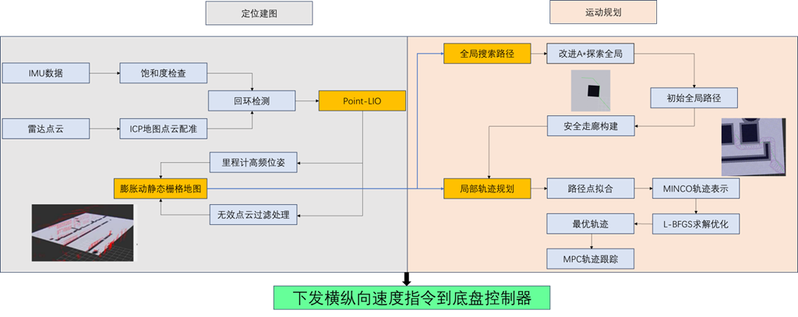

# RoboMaster 2026 — 毅恒团队哨兵导航系统

> 北京理工大学(珠海) · 毅恒团队 · 哨兵机器人自主导航系统

## 项目简介

本项目为 RoboMaster 2026 机甲大师赛哨兵机器人的导航系统，基于 **ROS2 Humble** 开发。系统通过 Livox MID-360 激光雷达进行环境感知，结合 Point-LIO 实现实时状态估计，使用 A\* 搜索与 MINCO 轨迹优化生成安全平滑的路径，最终由 MPC 控制器驱动机器人全向移动。

## 算法结构



## 项目系统架构

```
┌─────────────────────────────────────────────────────────┐
│                     Livox MID-360                       │
│                   (激光雷达硬件)                          │
└─────────────────────┬───────────────────────────────────┘
                      │ /livox/lidar
                      ▼
┌─────────────────────────────────────────────────────────┐
│              livox_ros_driver2 (Submodule)              │
│              Livox 官方 ROS2 驱动                         │
└─────────────────────┬───────────────────────────────────┘
                      │ pointcloud
                      ▼
┌─────────────────────────────────────────────────────────┐
│              small_point_lio (Submodule)                │
│         Point-LIO: 激光惯性里程计 + 实时建图                │
│         输出: /Odometry, /cloud_registered               │
└──────────┬──────────────────────┬───────────────────────┘
           │ /Odometry            │ /cloud_registered
           ▼                       ▼
┌──────────────────────────────────────────────────────────────┐
│                   path_planning                              │
│  A* 全局搜索 → 关键点提取 → 安全走廊 → MINCO 轨迹优化              │
│  订阅: /Odometry, /cloud_registered, /goal_pose               │
│  发布: /planned_path, /planned_trajectory, /obstacle_grid_map │
└─────────────────────┬────────────────────────────────────────┘
                      │ /planned_trajectory
                      ▼
┌─────────────────────────────────────────────────────────┐
│                     go_go_go                            │
│    MPC 控制器 + 指令调度 + 串口通信                         │
│   订阅: /planned_trajectory, /Odometry, /target_number   │
│   发布: /target_pos (速度指令), /goal_pose                │
└─────────────────────┬───────────────────────────────────┘
                      │ 速度指令 (串口/ROS消息)
                      ▼
┌─────────────────────────────────────────────────────────┐
│                   底盘控制 (全向轮)                       │
└─────────────────────────────────────────────────────────┘
```

## 功能包说明

### 1. `nav_bringup` — 统一启动

| 项目 | 说明 |
|------|------|
| **功能** | 一键启动所有导航节点 + RViz2 可视化 |
| **启动文件** | `start.launch.py` |
| **依赖** | nav2_bringup, navigation2 |

启动流程：Livox 驱动 → Point-LIO → 路径规划 → MPC 控制 → RViz2

### 2. `path_planning` — 路径规划

| 项目 | 说明 |
|------|------|
| **功能** | 全局路径搜索、安全走廊生成、MINCO 轨迹优化 |
| **核心算法** | A\* 搜索 + 关键点提取 + 凸多边形安全走廊 + MINCO 轨迹优化 |
| **输入** | `/Odometry` (里程计), `/cloud_registered` (点云), `/goal_pose` (目标点) |
| **输出** | `/planned_path`, `/planned_trajectory` (带速度的轨迹), `/obstacle_grid_map` |

**关键节点：**
- `path_planning_node` — 主节点，整合感知、规划、优化全流程
- 支持从 PCD 文件加载全局静态地图
- 动态障碍物实时更新，静态/动态障碍物分离管理
- 安全走廊可视化 + 轨迹速度向量可视化

**参数 (path_planning.params.yaml)：**

| 参数 | 默认值 | 说明 |
|------|--------|------|
| `odom_to_map_x/y` | 3.5 / 7.5 | odom→map 坐标系偏移，用来选择初始点 |
| `maptransform_x/y` | -0.9 / -0.55 | 全局地图和预设地图显示位置对齐微调 |
| `global_z_min/max` | -1.0 / 1.0 | 全局地图点云 Z 轴过滤 |
| `local_z_min/max` | -0.25 / 0.8 | 局部障碍物 Z 轴过滤 |
| `grid_radius` | 4 | 障碍物膨胀/搜索半径 |
| `map_size_x/y` | 280 / 150 | 栅格地图尺寸 (放大10倍) |
| `enable_load_global_map` | true | 是否加载 PCD 全局地图 |

### 3. `go_go_go` — 运动控制

| 项目 | 说明 |
|------|------|
| **功能** | 指令调度 + MPC 轨迹跟踪 + 速度下发 |
| **核心算法** | OSQP 求解的线性 MPC（三状态模型: x, y, yaw） |
| **输入** | `/planned_trajectory`, `/Odometry`, `/target_number` (接收电控决策指令) |
| **输出** | `/target_pos` (底盘速度指令), `/goal_pose` (导航目标) |

**指令集 (`/target_number` Int16)：**

| 指令 | 功能 | 说明 |
|------|------|------|
| 0 | 急停 | 立刻停止并清空轨迹 |
| 1 | 返回补给点 | 回到 `origin_x, origin_y` |
| 2 | 前往大符 | 前往能量机关位置 |
| 3 | 左巡逻点 | 预设左路巡逻位置 |
| 4 | 右巡逻点 | 预设右路巡逻位置 |
| 5 | 后巡逻点 | 预设后方巡逻位置 |
| 6 | 前巡逻点 | 预设前方巡逻位置 |

**MPC 参数：**

| 参数 | 默认值 | 说明 |
|------|--------|------|
| `mpc_horizon_` | 20 | 预测时域长度 |
| `dt_` | 0.1s | 控制时间步长 |
| `max_lin_speed` | 0.7 m/s | 最大线速度 |
| `max_lin_accel` | 0.8 m/s² | 最大线加速度 |
| `EARLY_STOP_THRESHOLD` | 0.15 m | 提前停靠距离 |

### 4. `livox_ros_driver2` (Submodule)

Livox 官方 ROS2 驱动，支持 MID-360 激光雷达。使用需修改雷达ID配置文件YH_Sentry_nav_2026/src/livox_ros_driver2/config/MID360_config.json

- 仓库：https://github.com/Livox-SDK/livox_ros_driver2
- 启动：`msg_MID360_launch.py`

### 5. `small_point_lio` (Submodule)

先进的 Point-LIO 激光惯性里程计算法，提供高精度实时位姿估计与点云配准。比赛场地地图点云文件存储在YH_Sentry_nav_2026/src/small_point_lio/pcd/

- 仓库：https://www.yanceymc.cn/gitea/Yancey/small_point_lio
- 输出：`/Odometry` (里程计), `/cloud_registered` (配准点云)
- 配置：`config/mid360.yaml`

## 环境依赖

| 依赖 | 版本要求 |
|------|----------|
| Ubuntu | 22.04 |
| ROS2 | Humble |
| CMake | ≥ 3.8 |
| Eigen3 | ≥ 3.3 |
| PCL | ≥ 1.12 |
| OSQP | 0.6.3 |
| Livox SDK2 | — |

### ROS2 包依赖

```
rclcpp, nav_msgs, sensor_msgs, geometry_msgs, trajectory_msgs,
tf2, tf2_ros, tf2_geometry_msgs, visualization_msgs, pcl_ros,
pcl_conversions, nav2_bringup, eigen, libosqp-dev
```

## 快速开始

### 0. 克隆项目

```bash
git clone https://github.com/normaldreammaker/YH_Sentry_nav_2026.git
cd YH_Sentry_nav_2026
```

### 1. 安装依赖

```bash
# 安装 OSQP 0.6.3(在下载osqp时需要指定版本，否则在编译osqp-eigen时会报下载错误)
git clone --recursive -b release-0.6.3 https://github.com/oxfordcontrol/osqp.git
cd osqp
mkdir build && cd build
cmake .. 
make
sudo make install

# 安装 OSQP-eigen 0.8.0
git clone -b v0.8.0 https://github.com/robotology/osqp-eigen.git
cd osqp-eigen
mkdir build && cd build
cmake .. 
make
sudo make install

# 安装 ROS2 依赖
rosdep install --from-paths src --ignore-src -r -y
```

### 2. 编译

```bash
# 第一次编译(详见YH_Sentry_nav_2026/src/livox_ros_driver2/README.md)
cd YH_Sentry_nav_2026/src/livox_ros_driver2
./build.sh humble

# 日常编译
cd YH_Sentry_nav_2026
colcon build
```

### 3. 启动

**完整导航系统：**

```bash
source install/setup.bash
ros2 launch nav_bringup start.launch.py
```

### 4. 发送导航指令（测试）

```bash
# 回补给点
ros2 topic pub /target_number std_msgs/msg/Int16 "data: 1"

# 前往打符点
ros2 topic pub /target_number std_msgs/msg/Int16 "data: 2"

# 前往左巡逻点
ros2 topic pub /target_number std_msgs/msg/Int16 "data: 3"

# 前往右巡逻点
ros2 topic pub /target_number std_msgs/msg/Int16 "data: 4"

# 前往右巡逻点
ros2 topic pub /target_number std_msgs/msg/Int16 "data: 4"

# 前往回防点
ros2 topic pub /target_number std_msgs/msg/Int16 "data: 5"

# 暂停移动
ros2 topic pub /target_number std_msgs/msg/Int16 "data: 0"
```

也可以通过 RViz2 的 `2D Goal Pose` 工具点击地图发送自定义目标点。

## 坐标系

```
map (全局固定坐标系)
  └── odom (里程计原点，由 static_transform_publisher 发布)
        └── base_link (机器人本体)
              └── livox_frame (LiDAR 安装位置，z+0.3m)
```

**关键变换：**
- `map → odom`: `(3.5, 7.5, 0.0)` — 静态变换，地图原点偏移
- `base_link → livox_frame`: `(0, 0, 0.3)` — LiDAR 安装高度

## 文件夹结构

```
YH_Sentry_nav_2026/
├── src/
│   ├── nav_bringup/          # 统一启动包
│   │   ├── launch/           # start.launch.py
│   │   └── rviz/             # RViz2 配置文件
│   ├── path_planning/        # 路径规划包
│   │   ├── include/          # A*, GridMap, MINCO, SafeCorridor
│   │   ├── src/              # 节点实现
│   │   ├── launch/           # 启动文件
│   │   └── config/           # 参数配置
│   ├── go_go_go/             # 运动控制包
│   │   ├── include/          # SerialPort 串口通信
│   │   ├── src/              # MPC 控制器 + 指令调度
│   │   ├── launch/           # 启动文件
│   │   └── config/           # 巡逻点/速度参数
│   ├── livox_ros_driver2/    # [Submodule] Livox LiDAR 驱动
│   └── small_point_lio/      # [Submodule] Point-LIO 里程计
├── .gitignore
└── README.md
```

## 技术要点

- **A\* 搜索** — 整数代价的 A\* 搜索，支持关键点提取简化路径
- **安全走廊** — 沿路径生成凸多边形安全区域，确保安全避障
- **MINCO 优化** — 最小控制量轨迹优化，生成位置-速度-时间联合轨迹
- **MPC 控制** — 三状态 (x, y, yaw) 线性 MPC，OSQP 高效求解
- **自适应前视** — 根据路径曲率和速度动态调整 MPC 前视距离
- **静动态分离** — PCD 静态地图与实时点云动态障碍物独立管理
- **坐标系转换** — 地图系→车体系的完整坐标变换链

## 许可

- 本项目：Apache-2.0
- `livox_ros_driver2`：参见其 [LICENSE](src/livox_ros_driver2/LICENSE.txt)
- `small_point_lio`：MIT License

---

> **毅恒团队 · 北理珠 · RoboMaster 2026**
